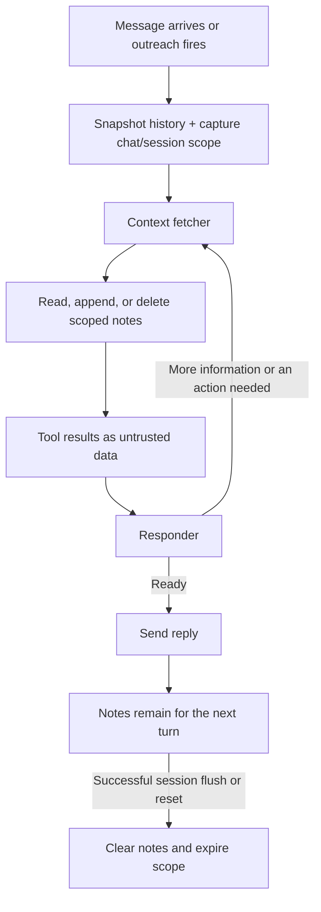

# Chat Scratchpad Implementation Plan

> **For agentic workers:** Use superpowers:executing-plans to implement this plan task by task.

**Goal:** Add temporary notes scoped to the application's current chat and buffer session.

**Architecture:** A synchronous typed RAM service owns active sessions and ordered notes. Strict LangChain tools receive scope and invocation-local URL observations through runtime configuration. Telegram captures scope under its buffer lock; both reply graphs use the same tools and data-message boundaries.

**Tech Stack:** Python 3.11+, Pydantic, LangChain, LangGraph, unittest. No dependencies or migrations.

**Spec:** `docs/superpowers/specs/2026-10-19-chat-scratchpad-design.md`

## Global Constraints

- 20,000 Python characters across titles, bodies, and source URLs per session.
- No model-facing chat/session/config arguments; absent or expired scope fails closed.
- Successful flush/reset/shutdown invalidates scope; failed persistence retains it.
- Contents are read on demand and never directly persisted or extracted as memory.
- Preserve retrieval pass limits; no HTTP/dashboard changes.

## Review Focus

- A stale graph must never revive an expired session or touch a replacement session.
- URL copying accepts only successful results from the current invocation.
- Invalid/overflowing appends and invalid ID lists leave storage unchanged.
- Tool arguments, results, and failures containing arbitrary text remain outside system messages.
- A summary persistence failure must retain scratchpad and pending summary.

### Task 1: Scoped storage and strict tools

**Files:** Create `app/services/scratchpad.py`, `app/services/scratchpad_tools.py`, `tests/test_scratchpad.py`.

**Interfaces:** Frozen `ScratchpadScope(chat_id: int, session_id: str)`; singleton `scratchpads` with `activate`, `invalidate`, `clear_all`, `metadata`, `read`, `append`, `delete`. `SCRATCHPAD_TOOLS` exposes get/append/delete; injected config carries `scratchpad_scope` and `scratchpad_url_results`.

- [x] Write tests for two-chat isolation, forged/missing/stale scope, foreign IDs, atomic validation, Unicode/exact capacity/reclaim, and text/URL copying.
- [x] Run `uv run --no-sync python -m unittest tests.test_scratchpad`; expect missing service, then implement storage/tools and expect PASS.

### Task 2: Buffer session lifecycle

**Files:** Modify `app/telegram/client.py`; create `tests/test_scratchpad_lifecycle.py`.

**Interfaces:** `_snapshot_context` returns `(messages, history, senders, ScratchpadScope)`. Reactive and proactive response entry points accept `scratchpad_scope`.

- [x] Write tests for atomic snapshot scope, shared proactive/reactive scope, successful/failed flush, inactivity/size finalization, reset, shutdown, and flush/reseed races.
- [x] Run lifecycle tests; expect missing scope/cleanup, then implement lifecycle under buffer locks and expect PASS.

### Task 3: Graph integration and documentation

**Files:** Modify `app/services/llm.py`, `app/services/prompt_builders.py`, `app/prompts.py`, affected prompt tests, `AGENTS.md`, `CLAUDE.md`; create `tests/test_scratchpad_graph.py`.

**Interfaces:** `_run_response_graph` forwards trusted scope through `RunnableConfig`; context fetcher supplies current invocation URL successes to scratchpad tools. Both agents receive only scratchpad metadata automatically, and observations in concrete untrusted human messages.

- [x] Write tests for both graphs, cross-turn retention, invocation-local URL copying, extra/forged config rejection, stale calls, metadata-only prompts, and untrusted text boundaries.
- [x] Run graph tests; expect unregistered tools/config/boundary failures, then implement graph plumbing and prompt guidance and expect PASS.
- [x] Synchronize repository instructions with the final interfaces and lifecycle.
- [x] Run `uv run --no-sync python -m unittest discover -s tests`, `uv run --no-sync python -m compileall -q app scripts alembic`, and dashboard tests; expect PASS (database integration tests skip without disposable Postgres).
- [x] Review the complete diff against the spec and fix material findings with regression coverage.

## Execution record

Implemented in the existing `feat/chat-scratchpad` checkout. Storage, lifecycle, and graph tests were written and run before the corresponding implementation. Read-only final review found one summary-saving race; a failing regression reproduced it, and conditional cleanup now preserves concurrent replacements. No deferred findings remain.

Final verification: 224 Python tests run, OK with 11 database integration tests skipped; syntax checks passed; all four dashboard tests passed. `AGENTS.md` and `CLAUDE.md` are synchronized. No dependencies or migrations were added. Changes remain uncommitted for review.

The scratchpad follows **one chat’s current buffer session**. Rachel can keep notes across several replies in that session, then the notes disappear when the session is flushed.

1. **Capture the right session with the conversation.**  
   When the buffer is initialized, the application activates its scratchpad. When preparing a reply, `_snapshot_context` captures both the history and `ScratchpadScope(chat_id, session_id)` under the same lock. This prevents a flush from slipping between those two operations. See [client.py](/Users/tuandingren/Documents/Rachel/app/telegram/client.py:213).

2. **Give the agents a small status summary.**  
   Both the context fetcher and responder automatically see note count, used capacity, and remaining capacity. Saved titles and bodies stay out of the prompt until a read is requested. The normal reactive admission flow still applies; proactive outreach uses the same scratchpad plumbing.

3. **Let the fetcher operate on notes.**  
   Only the context fetcher executes the three tools:
   - `get_scratchpad()` reads all notes or selected IDs.
   - `append_scratchpad()` saves text or copies a fetched page.
   - `delete_scratchpad()` deletes selected IDs; explicit `null` clears the current pad.

   The application injects scope through runtime configuration. The model cannot supply a chat or session ID. Every operation checks that the scope is valid and still active; foreign note IDs behave as missing. See [scratchpad_tools.py](/Users/tuandingren/Documents/Rachel/app/services/scratchpad_tools.py:33).

4. **Validate everything before changing storage.**  
   Notes live in RAM, in insertion order. Appending checks the **20,000-character limit**, counting title, body, and source URL. Invalid or oversized appends leave the pad unchanged. Deleting notes immediately reclaims capacity. These operations contain no awaits, so another task cannot interrupt validation and mutation. See [scratchpad.py](/Users/tuandingren/Documents/Rachel/app/services/scratchpad.py:95).

5. **Return results through the existing retrieval loop.**  
   Note contents and other tool-result text reach the agents as explicitly untrusted data outside system messages. The responder can answer or request another fetcher pass, subject to the existing pass limit.

   For example, the fetcher can fetch an article and append it using `from_url` without fetching again. That shortcut works only for a successful URL result from **the current graph invocation**. On a later turn, Rachel reads the saved note instead.

6. **Clear notes only after successful cleanup.**  
   Inactivity, the buffer-size limit, shutdown flushing, and explicit history resets invalidate the old scratchpad scope. If persistence fails, the notes remain available. If an old model call finishes after cleanup, its expired scope is rejected—even if a new session has already started for that chat. See [client.py](/Users/tuandingren/Documents/Rachel/app/telegram/client.py:656).

I also fixed the summary-save race found during review: if a newer summary arrives while the previous one is being saved, cleanup now preserves the newer value.